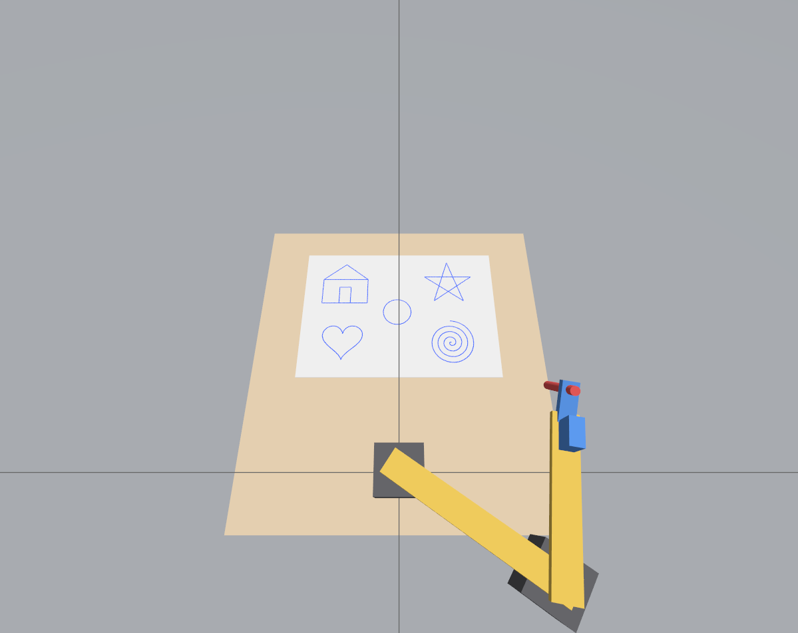

# drawbot

A pen-plotter arm simulated in ROS 2 Jazzy + Gazebo Harmonic.



Two NEMA 17 steppers drive a jointed two-link arm (shoulder and elbow), and a
hobby servo at the end of the arm tilts the pen on and off the paper.

| Joint            | Actuator | Motion                                   |
|------------------|----------|------------------------------------------|
| `shoulder_joint` | NEMA 17  | turns link 1 about the base              |
| `elbow_joint`    | NEMA 17  | turns link 2 about the end of link 1     |
| `pen_lift_joint` | servo    | 0 rad = pen on paper, 0.35 rad = lifted  |

Both links are 140 mm; the paper is an A5 sheet in front of the base.

## Build

```bash
cd ~/drawbot_ws
source /opt/ros/jazzy/setup.bash
colcon build --symlink-install
source install/setup.bash
```

Needs `ros-jazzy-ros-gz`, `ros-jazzy-xacro` and `ros-jazzy-robot-state-publisher`.

## Run

```bash
ros2 launch drawbot sim.launch.py
```

| Argument      | Default | Meaning                                                    |
|---------------|---------|------------------------------------------------------------|
| `gui`         | `true`  | show the Gazebo window (`false` = headless server)         |
| `rviz`        | `false` | also open RViz with the robot model and pen trail          |
| `gpu`         | `true`  | under WSL2, render with the D3D12 driver instead of llvmpipe |
| `microsteps`  | `16`    | stepper microstepping; `0` models ideal motors             |

Then, in a second terminal:

```bash
ros2 run drawbot draw demo                       # fill the sheet with sample shapes
ros2 run drawbot draw star --size 0.06           # one shape, centred on the paper
ros2 run drawbot draw circle --x 0.20 --y 0.05   # ...or somewhere else (metres)
ros2 run drawbot draw clear                      # wipe the paper
ros2 run drawbot draw home                       # park the arm
ros2 run drawbot draw stop                       # abandon queued strokes
```

Shapes: `square`, `triangle`, `circle`, `star`, `heart`, `spiral`, `house`.

## Drawing your own paths

Publish a `geometry_msgs/PoseArray` to `/drawbot/stroke`. Each message is one
polyline in the `base_link` frame (metres, x away from the base, y to the
left); the arm lifts the pen, travels to the first point, lowers the pen and
traces the rest. The paper covers x 0.090-0.238, y -0.105-0.105.

## Interfaces

| Name                           | Type                               | Purpose                       |
|--------------------------------|------------------------------------|-------------------------------|
| `/drawbot/stroke`              | topic, `geometry_msgs/PoseArray`   | polyline to draw              |
| `/drawbot/busy`                | topic, `std_msgs/Bool` (latched)   | true while motion is queued   |
| `/drawbot/trail`               | topic, `visualization_msgs/MarkerArray` | ink, for RViz            |
| `/drawbot/{shoulder,elbow,pen_lift}/cmd_pos` | topic, `std_msgs/Float64` | joint position commands |
| `/joint_states`                | topic, `sensor_msgs/JointState`    | simulated joint angles        |
| `/drawbot/home`, `/drawbot/stop`, `/drawbot/clear` | service, `std_srvs/Trigger` | park / abort / wipe |

## Layout

```
src/drawbot/
  urdf/drawbot.urdf.xacro   robot geometry, joints and Gazebo plugins
  worlds/drawing.sdf        Gazebo world and GUI layout
  config/bridge.yaml        ROS <-> Gazebo topic bridge
  launch/sim.launch.py      starts everything
  drawbot/kinematics.py     forward / inverse kinematics, paper geometry
  drawbot/controller_node.py  strokes -> joint commands
  drawbot/trail_node.py     joint states -> ink in Gazebo and RViz
  drawbot/shapes.py         shape generators
  drawbot/draw_cli.py       the `draw` command
  test/                     kinematics tests (pytest)
```

## Notes

- The ink is drawn by `trail_node` from the simulated joint angles; the pen
  tip hovers 0.5 mm above the paper rather than making physical contact.
- Link lengths and paper placement appear in both the xacro and
  `kinematics.py`; change them together.
